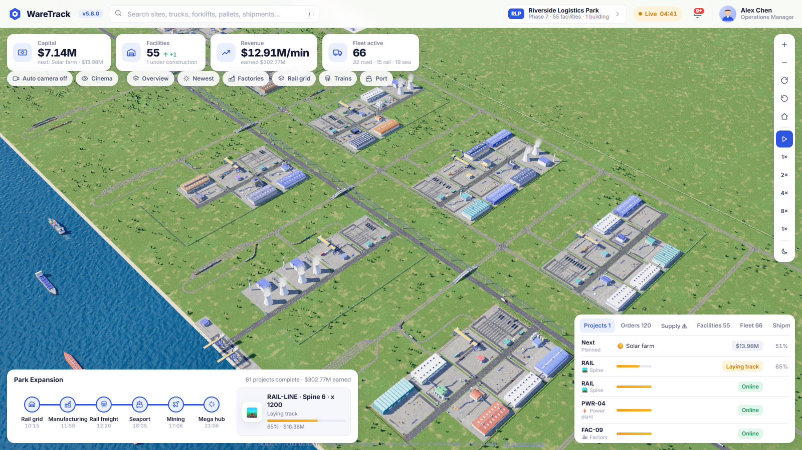
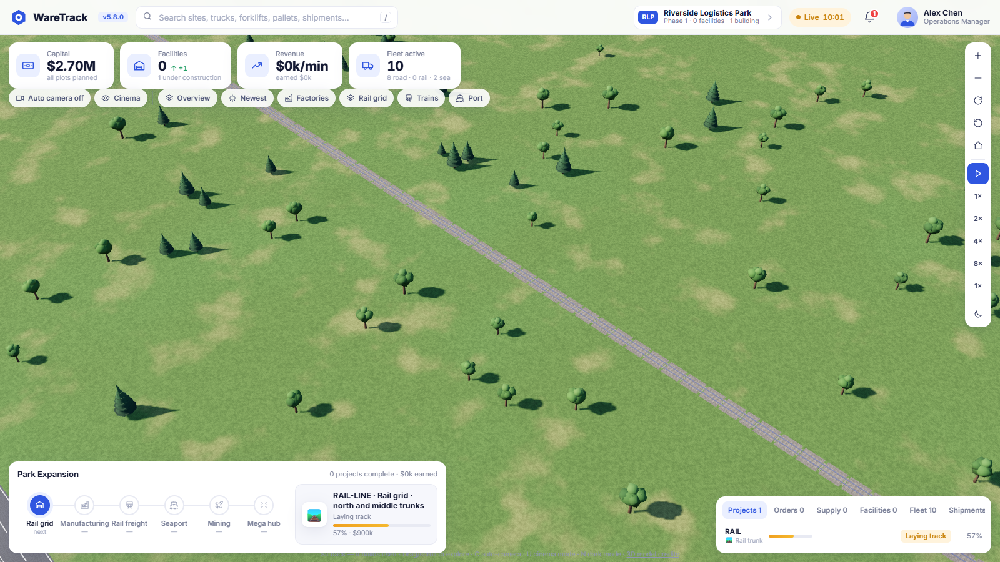
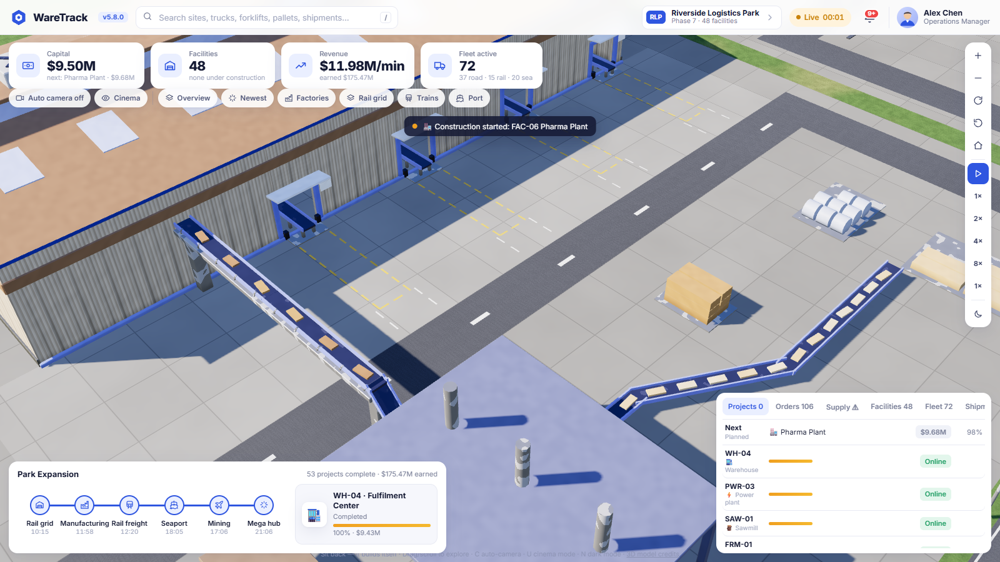
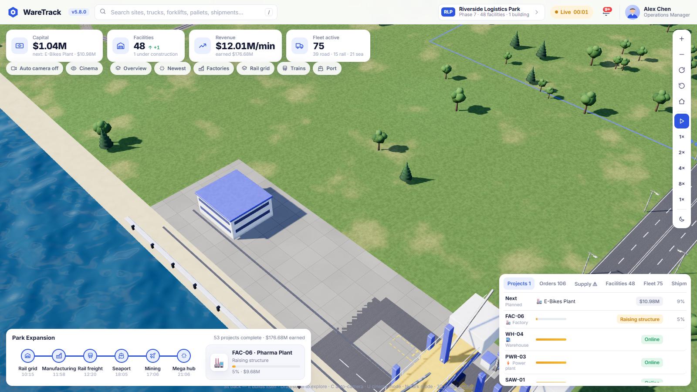
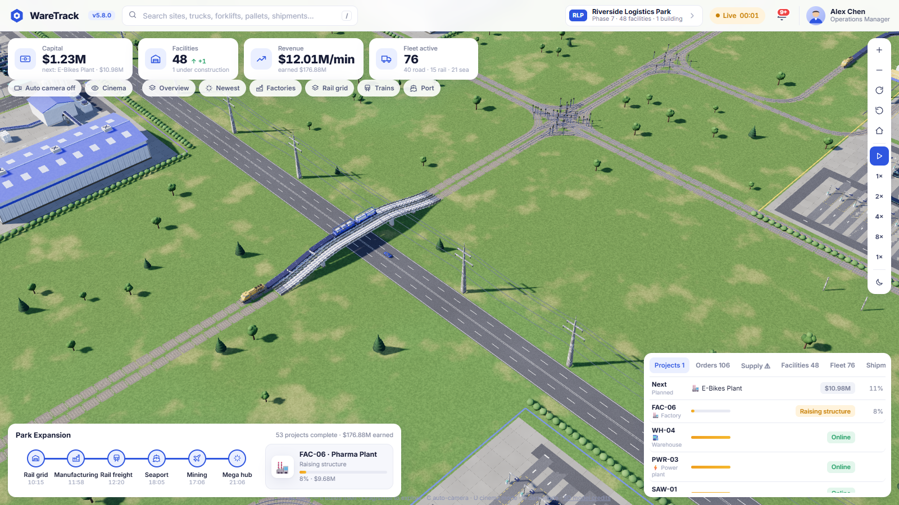
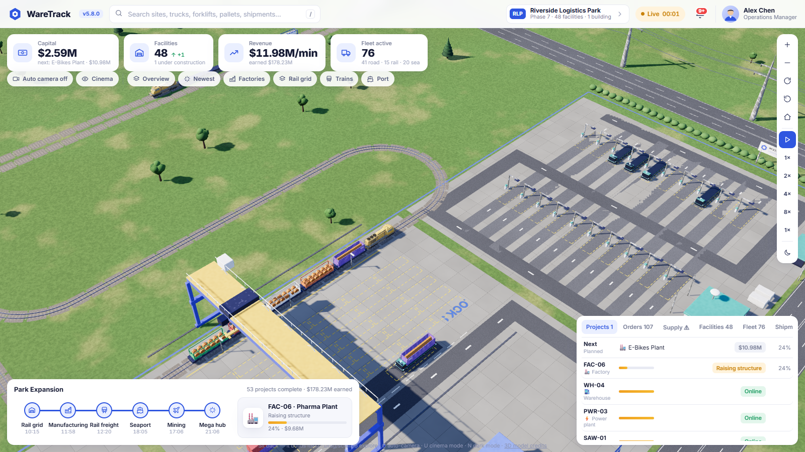
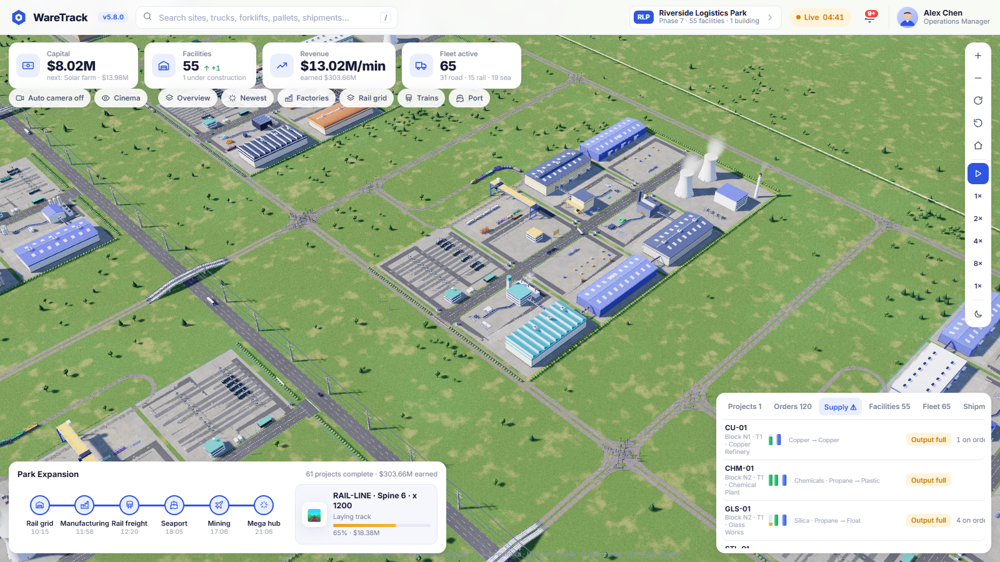
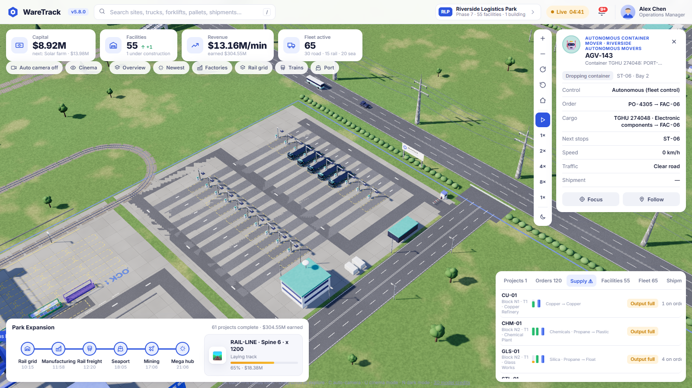
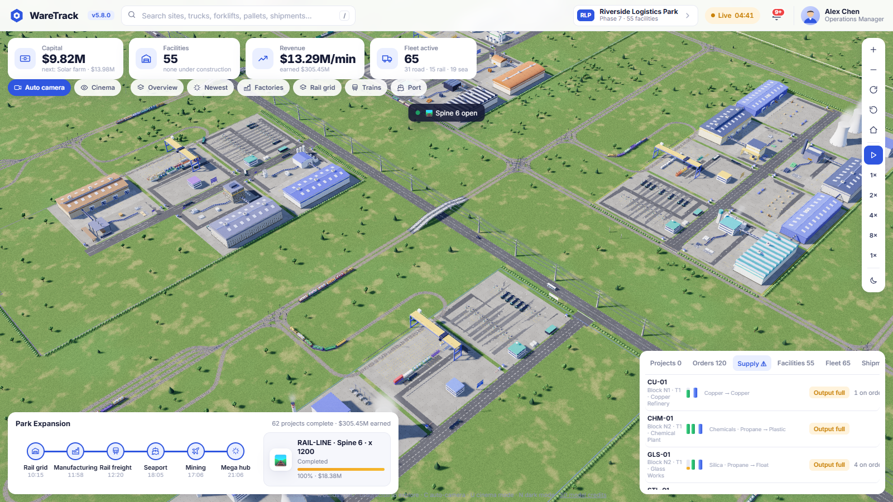

<p align="center">
  
</p>

<h1 align="center">WareTrack</h1>

<p align="center">
  <b>A logistics park that builds and runs itself. Sit back and watch.</b><br/>
  A whole map laid out around a rail grid, feeding a live, multi-stage supply chain, rendered as a lifelike 3D world in the browser.
</p>

<p align="center">
  <a href="__LIVE_URL__"><b>▶ Live demo</b></a> ·
  <a href="#screenshots">Screenshots</a> ·
  <a href="#run-it-locally">Run locally</a> ·
  <a href="#development">Development</a>
</p>

<p align="center">
  <a href="https://github.com/corund207/waretrack/actions/workflows/ci.yml"></a>
  
  
  
  <a href="LICENSE"></a>
</p>



It starts as empty land with a highway, a forest and a coast. A director AI earns capital, plans projects and builds
everything itself, and the first thing it builds is track: two double-track trunks across the whole map. Every block
of the map then opens around the rail grid: a spine is laid past it, its station loop goes in, and only then its
plants, distribution centres and utilities, with tower cranes, mixer trucks and buildings rising floor by floor. Each
facility joins a fully simulated supply chain, where every container and tanker load is a real object you can click and
follow from the ship, the mine or the map edge all the way to the factory dock.

No build step and no framework: plain JavaScript and [three.js](https://threejs.org), served as static files.

## Screenshots

| | |
|---|---|
|  **Day one.** Bare land, the first plot being paved and built. |  **Factory receiving.** Raw material arrives at the dock and belts feed the process line. |
|  **Seaport.** STS cranes discharge the exact containers each purchase order was booked on. |  **Rail grid.** A spine crossing the middle trunk at a full junction, signals at every conflict. |
|  **Block station.** A shuttle at the platform under the gantry, movers at the truck bays. |  **Supply panel.** Live plant stockpiles, stations, movers and freight bookings. |
|  **Everything is clickable.** A vehicle with its order, container and traffic state. |  **Cinema mode.** An autonomous camera director with the dashboard hidden. |

## Run it locally

```
npm start              # serves the source at http://localhost:8000 (next free port if 8000 is taken)
npm run start:dist     # builds, then serves dist/ exactly as deployed
```

The server is plain Node (no dependencies, no `npm install` needed) and sends `no-store` headers so a reload always
picks up edited code. `--port`, `--host 0.0.0.0` and `PORT=…` are supported. Opening `index.html` directly also works. three.js is bundled in `js/vendor/`. The version badge next to the logo
shows which build you are looking at (deployed builds also show the commit hash).

## What grows

| Phase | What appears |
|------|--------------|
| Rail grid | The **north trunk** and the **middle trunk** go down first, double track the width of the map, with portals at both edges where freight comes and goes, and the link to the **mine line** |
| Manufacturing | **Factories** in three tiers (refining → components → final assembly), every kind with a building design of its own (blast furnace and coke ovens, potline, distillation columns, clean room, high-bay press hall, test cells…). Each grows in its own **block**, after the block's **spine**, **station** and **mover depot**; final assembly belts its cartons into a distribution centre next door |
| Rail freight | **Freight** runs in from the portals with imports, straight to the station of the block that ordered them, and leaves with the blocks' product crates. **Block shuttles** carry boxes between blocks. Every spine has a **stabling yard** at its foot |
| Seaport | A **port terminal** on the coast, in a block of its own with its own station: ship-to-shore cranes discharge, movers carry the boxes to the station, and they go on by rail |
| Mining | **Ore trains** collect empties at the container works, load at the iron and coal mines, the bauxite pit, the sand quarry and the grain farm, and run straight to the blocks that use them. The gas field pipes chemicals and propane to the plants |
| Mega hub | Power plants with steaming cooling towers and pylon lines along the highway, solar farms, tank farms, substations, water towers and an HQ tower filling the utility blocks, and the rest of the spines laid |

The map is a grid of **14 blocks**: seven columns, each north or south of the highway. A block is two rows of four
plots either side of a short road of its own, and that road never meets the highway: nothing crosses the map by road.
Between blocks everything moves by train; inside a block, **autonomous container movers** carry each box the last
hundred metres between the station and a dock. No raw material is ever trucked in from outside: every input arrives
by train, ship or pipeline (or from another plant). The highway keeps its through traffic. A full build-out takes
roughly an hour at 1× (use 2×/4×/8× to speed it up).

## Supply chain: order-driven and physically traced

**Purchase orders.** Each plant keeps live stockpiles of its inputs, shown as ore heaps, coil rows, log stacks,
crates and tank levels. When stock plus open orders falls below the reorder point, it raises a purchase order. The
order is routed the way it would be in real life:

| Mode | What happens |
|------|--------------|
| **Sea** | The order is booked on the next vessel. The ship arrives with *that* container on deck, the STS crane discharges it straight onto a container mover waiting on a crane spot, and the mover drives that exact box to the plant |
| **Rail** | The order rides a specific freight wagon in from the map edge (ore trains bring bulk in open-top bins) to the station of the plant's block. The gantry grounds it and a container mover takes it to the plant |
| **Pipeline** | Chemicals and propane are pumped from the gas field straight into the plant's tanks |
| **Transfer** | A mover is loaded at the producer's shipping bay. In the same block it drives straight to the consumer; otherwise it drops the box at its station, a block shuttle carries it to the consumer's block, and a mover there takes it the last stretch |

A box landed at the port for another block goes by mover to the port block's station and on by rail. Liquids travel
in ISO tank containers and are pumped off through a hose; open loads (ore, coal, logs, coils, glass) ride in
open-top bins and flat-racks with the cargo in view. After unloading, a mover takes its empty back to its block's
station, where a small pool of empties is kept for the next transfer.

**The mover fleet.** Every block has its own **mover depot**, with 20 drive-through charging bays under pantograph
charging masts, and its movers never leave the block. A job takes a charged mover from the block of its first stop. It
drives out, works its legs and comes back to its own bay; if another container is already waiting when it drops an
empty, it takes that job straight on. A station's truck bays are booked when a mover is dispatched, so movers never
queue out on the road. Each depot opens with 8 movers, keeps a reserve for factory supply, and commissions another
whenever its block's jobs wait for one.

Stock only rises when the delivery is physically received at the dock: containers are opened and destuffed,
tanks pumped through a hose. Click any container, train or vehicle to see its order and full journey log.
The **Orders** tab follows every order from placement to delivery.

**Multi-stage industry**

Production runs in **three tiers**, each in blocks of its own: Metals and Materials (refining) next to the mines in
the north-west, Drives & Circuits and Bodies & Fittings (components) beside them, and three assembly blocks in the
middle of the map, each line belting its cartons into a distribution centre next door. One plant of each kind supplies
every line that uses its output. The Port block sits on the coast, and the rest are utility blocks.

**The rail grid**, laid out like a big rail base: double-track running lines (one track each way, trains keep right)
with full junctions, and every stop on a loop of its own.

- The **north trunk** and the **middle trunk** (just north of the highway) run the width of the map and off both
  edges, where freight enters and leaves.
- A **spine** runs north–south between every two columns of blocks: from a T-junction on the north trunk, across the
  middle trunk at a four-way junction, over the highway on a viaduct, down to a **stabling yard** with four roads on a
  balloon at its foot, where idle trains wait.
- Each block's **station** sits on a loop off its spine. Trains turn in from either direction, work the platform
  under the station's gantry, run round the loop and leave either way. One more train can wait inside the loop while
  the platform is busy.
- The **mine line**, the branch past the container works and the mines, feeds the north trunk from the west.

Junctions are signalled. A train reserves every conflict ahead of it in a junction at once (the merges, diverges and
crossings it will foul) and releases each as its tail clears it, so trains never meet and never stop inside a
junction. Signal masts show red while a conflict is held.

- **Block shuttles** carry boxes between blocks: deliveries first, collections on the way.
- **Freight** brings imports in from the map edge straight to the blocks and takes the product crates away.
- **Ore trains** run up the mine line, collect empties at the container works, load at the mine and run straight to
  the block that ordered the ore.

| Tier 1 · Refining | Turns | Into |
|-------------------|-------|------|
| Steel Mill | Iron ore + coal | Steel coils |
| Copper Refinery | Copper ore | Copper cathodes |
| Aluminium Smelter | Bauxite | Aluminium ingots |
| Chemical Plant | Chemicals + propane | Plastic resin |
| Sawmill | Timber logs | Lumber |
| Glass Works | Silica sand + propane | Float glass |

| Tier 2 · Components | Turns | Into |
|---------------------|-------|------|
| Wire Mill | Copper cathodes | Copper wire |
| Motor Works | Steel + copper wire | Electric motors |
| Circuit Fab | Copper + resin + electronic components | Circuit boards |
| Panel Press | Steel + aluminium | Body panels |
| Moulding Shop | Resin | Plastic housings |
| Frame Shop | Lumber + steel | Furniture frames |

| Tier 3 · Final assembly | From |
|-------------------------|------|
| Electronics | Circuit boards + housings + glass |
| Appliances | Motors + body panels + housings |
| Auto Parts | Motors + body panels + circuit boards |
| E-Bikes | Motors + aluminium + circuit boards |
| Solar Panels | Glass + aluminium + circuit boards |
| Machinery | Motors + steel + circuit boards |
| Furniture | Frames + textiles |
| Beverages | Glass + syrup + grain |
| Pharma | Chemicals + electronic components |

Final-assembly plants send finished cartons over a belt bridge into their paired distribution centre. From there,
goods go out in **WareTrack product crates**: a mover fills one at the dock and drops it at the block's station for
the next freight out. Until the map makes a material itself, it is imported by rail or sea. The planner builds
supply bottom-up: a component plant once enough assembly lines use its part, a refinery once enough component plants
(or lines) use its stock. Plants starve, visibly and on their cards, when a delivery is late, and run out of space
("Output full") when nobody collects. The **Supply** tab lists every plant by tier.

**Loads you can see.** Raw materials from ships and trains travel in **open-frame containers**: open-tops heaped
with ore or sand, and flat-racks carrying crates or glass on A-frame racks. Cranes lift them with the cargo in plain
view. Utility trailers show what they carry too: steel coils in cradles, log stakes, lumber bundles and wire reels.
At the factory dock each piece is swung off the top of the load onto the dock belt, so the load visibly shrinks until
the bed is bare. At a producer's shipping bay, a shuttle's bed fills from the headboard back as product comes off
the line.

**The seaport runs on a container terminal engine**, `js/terminal.js`:
- **Cranes acting as one.** The two quay cranes share one pair of rails. Split
  lines divide the yard between them and follow the queued work, so each crane gets an equal share. Each crane
  takes only lifts in its own stretch, so all work at the same time without blocking each other. When one crane
  runs short of work its lines shift toward it. A lift that spans two stretches goes ahead with rail claims, and the
  neighbour steps aside, with trucks taking priority.
- **Truck lanes with a bypass.** Each crane area has a service lane with numbered spots and a bypass lane beside it,
  so trucks can drive around parked ones and enter or leave in any order. Each spot has a straight run-in, so the
  rig is square before it stops.
- **Forward thinking.** At the gate a mover is given the spot nearest its box. Once it's a few seconds out, the crane
  is already lifting the box and holding it over the spot. Movers are dispatched as soon as the ship arrives, and a
  box still aboard goes straight from the deck onto the mover.
- **Never parked.** An idle crane moves to where its next work will be, or restacks boxes nearer the truck spots.
- **Empties go to the station.** Empties piling up at the port go by mover to the port block's station pool.

**Seaport traffic.** Separate inbound and outbound tracks, and an anchorage where the next ship waits while the berth
is busy. Ships enter and leave only with clearance, two harbour tugs escort them on and off the berth, and moving
ships leave a wake.

**Roads.** The highway runs straight across the map with through traffic only. Each block has a short road of its own,
two lanes each way, that starts at a turning head behind a hedge and never meets the highway; construction crews come
in along it and leave the same way.

**Distribution centers.** Movers drive down the yard road, pull past their door and reverse square onto the
dock, guided by bay lines. They pull straight out when they're done. The roller door opens, and a dock forklift
inside drives onto the leveler and puts its forks into the trailer, one pallet at a time. Separate **forklift doors**
between the dock doors, with yellow guard posts and marked walkways, let the yard forklifts carry pallets between
the outdoor yard and the building. They stage stock out when the yard runs low and put it away when it fills up.

**Realistic handling:** station and terminal appointments, staging lanes inside plant gates, a pool of empties at
every station, and long lead times for imports that primary plants buffer against.

## Traffic

- Collision avoidance: each vehicle knows its body shape, follows the car ahead, predicts crossing conflicts and
  yields by right of way (junction > highway > avenue > yard). A deadlock breaker handles circular waits.
- **Dispatch metering.** Dispatch watches how much traffic is queued. It meters new mover releases when a block's
  road gets busy and holds them when it's jammed (see *Supply → Roads*).
- **Articulated semis.** Every rig is a tractor and a semi-trailer hinged at the fifth wheel. Pulling forward, the
  trailer trails the tractor through bends like a real one and cuts slightly inside. Reversing onto a dock, the
  trailer leads and the tractor follows it in. Collision bodies follow both parts.
- **Off-street docking.** Every unload path is laid out clear of buildings, belts, stockpiles, crane legs and pylons,
  and a geometry audit checks each vehicle's full body sweep. Factories have a **drive-through receiving road**: movers
  enter at one gate, run down a bypass lane, pull alongside a bay beside the dock wall, are unloaded sideways onto
  the dock belt and drive straight on out of the other gate, never reversing. At warehouses, movers pull past the
  bay and **reverse onto the dock**, while traffic behind holds back to give them room. At stations and the port,
  movers enter and leave the crane lanes from the ends, outside the gantry's travel. Yard forklifts yield to moving
  vehicles.
- **Gate barriers** lift for vehicles at every plot entrance. Terminals add an OCR portal where trucks stop for the
  gate-in check.
- The vehicle card's *Traffic* row says why a vehicle is waiting: exit blocked, or queued behind another vehicle. A
  train's status says when it is held at a signal.
- The version is shown next to the logo (currently **v5.8.0**). Hard-refresh (Ctrl+F5) if it doesn't match.
- Vehicle variety: cab-over and long-hood rigs; box, curtainsider, reefer, tanker, coil, log, container and dump
  trailers; concrete mixers; sedans, SUVs, vans, pickups and coaches. Trains carry container flats with boxes, tanks
  and open loads, and tankers and bulk carriers pass offshore.

## Watching

- **Auto camera** (on by default, **C**) cuts to new construction, freighters on approach, trains arriving and ships
  berthing. Between events it follows trucks, shows factory belts and gives slow orbits and overviews. Any mouse or
  keyboard input hands you control, and it resumes after 30 s.
- The **Rail grid** chip flies out over the whole map, and **Trains** follows the busiest train on the grid.
- **Cinema mode** (**U**) hides the dashboard and leaves a slim status ticker.
- **Dark mode** (**N**, or the moon button in the map toolbar) switches the dashboard to dark and the park to night:
  a moonlit sky, with street lamps, headlights and office windows lit. It follows your system setting until you
  pick one, then remembers your choice.
- Click anything for its live detail card, and use **Follow** to ride along with a vehicle.
- Drag to pan, scroll to zoom, right-drag or **Q/E** to rotate, right-drag up/down or **R/F** to tilt (down to the
  horizon), **H** home, **/** search, **Space** pause, **1–4** set speed.

## Code map

- `js/core.js`: sim clock, coroutines, path following, traffic yielding
- `js/look.js`: the lifelike look: physically based materials, real-world palette, procedural grass, asphalt,
  concrete, gravel and water, sky dome with sun, haze and clouds, image-based lighting, night lights
- `js/assets.js`: downloaded 3D models (truck cabs, cars, vans, the 787, locomotives, forklifts): decoded from
  `js/models_data.js`, fitted to the park and cloned per vehicle; the hand-built models are the fallback
- `js/models.js`, `js/models_ext.js`: hand-built models (merged vertex-coloured geometry with chamfered edges)
- `js/world.js`: terrain, highway, coast, instanced forest, block plots and roads, road router, pylons
- `js/fx.js`: smoke, steam and dust particles, and instanced conveyor belts
- `js/fac_*.js`: facilities (warehouse, factory, port, mines and gas field, mover depot, utilities; the mainline rail terminal and the airport are no longer built)
- `js/plant_designs.js`: a building design for every kind of plant
- `js/ring.js`: the rail grid and its blocks: trunks, spines, junctions, station loops, signalled conflicts, stabling yards, block stations, shuttles, freight, ore trains
- `js/traffic.js`: traffic engine (avoidance, signals, gates), vehicles, multi-leg missions, ambient traffic
- `js/supply.js`: materials, recipes, container contents and journeys, demand-driven dispatcher
- `js/models_fleet.js`: rigs and trailers, cars and buses, wagons, ships, signals, barriers, lamps
- `js/growth.js`: economy, project planner, construction sequence, milestones
- `js/cinema.js`: autonomous camera director
- `js/ui.js`, `js/main.js`: dashboard, renderer, input, overlays, main loop
- `js/theme.js`: light / dark theme for the dashboard and the 3D scene

## Development

```
npm install            # dev dependency: puppeteer (headless Chrome for the tests)
npm test               # static checks → build → simulation test
npm run screenshots    # regenerate docs/screenshots and docs/social-preview.png
npm run pack-models    # re-pack assets/models/*.glb into js/models_data.js after changing a model
```

- `npm run test:static` parses every script, makes sure every asset referenced by `index.html` exists, and checks that
  every cache-busting tag and `package.json` match `WT.VERSION`.
- `npm run build` copies the site to `dist/`, tags every asset URL with a hash of the file contents (so any change
  busts browser caches, even for uncommitted work) and stamps the version badge with the commit hash.
- `npm run test:sim` boots the built site in headless Chrome with a fixed random seed and grows the park through
  most of a day. It fails on any page error, on stalled growth or unfed factories, on two trains meeting, on a mover
  leaving its block, on vehicles piling into each other or traffic locking up, or if any truck path (docks, reverse
  manoeuvres, staging lanes, block roads) sweeps through a building, belt, stockpile, crane or tree.

### CI / CD

[`.github/workflows/ci.yml`](.github/workflows/ci.yml) runs on every push and pull request:

1. **Test**: static checks, build, then the full simulation test.
2. **Deploy**: only runs if the tests pass. `main` goes to **production** on Vercel, and other branches get a
   **preview** URL.

Deployment needs three repository secrets: `VERCEL_TOKEN`, `VERCEL_ORG_ID` and `VERCEL_PROJECT_ID`. Vercel's own
Git auto-deploys are switched off in `vercel.json`, so nothing reaches the live site without passing CI.

## Credits

The realistic vehicles are CC BY 4.0 models from Sketchfab, optimised for the park with
[`scripts/optimise-models.mjs`](scripts/optimise-models.mjs). The full list, with links, is in
[`assets/models/CREDITS.md`](assets/models/CREDITS.md):

- **DAF XF105** tractor unit by Alvin.Woodly
- **BMW E30** by roh3d
- **Mercedes-Benz G-Class** by Lexyc16
- **DHL delivery van** by maregajavier
- **Boeing 787 Dreamliner** by maurogsw
- **Diesel locomotive** by Leaf_dev
- **Warehouse forklift** by absologixemployee

## License

[MIT](LICENSE) for the code. three.js is © Three.js Authors (MIT). The 3D models in `assets/models` (and packed in
`js/models_data.js`) keep their own CC BY 4.0 licences; see [Credits](#credits).

